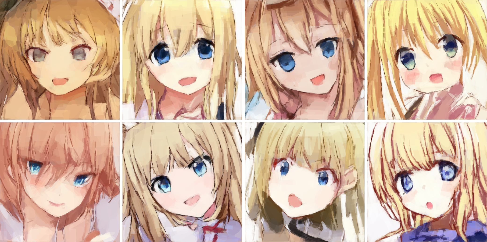

# Primitive Operation Painter 2

English | [中文](README.zh-CN.md)

> **This fork adds Bezier edge control.** Rectangle rims can be bent by four quadratic
> Bezier controls, so a single primitive can form a curved stroke. Protocol, results and
> build notes: **[BEZIER.md](BEZIER.md)**.

**Looking for POP 1?** [Original version snapshot](https://github.com/wonderfulearth/primitive-operation-painter/tree/pop1-144step) · [Preserved files](legacy/pop1/) · [Original introduction](legacy/pop1/README.md)

**An autoregressive image model that draws through editable primitive operations.**

Primitive Operation Painter 2 (POP 2) builds an image by predicting a background and a sequence of rectangles and ellipses. Each shape has explicit geometry and color. The drawing process remains available as data: you can inspect it, change a shape, return to an earlier state, and let the model continue from your changes.

This project explores a shared drawing representation for people and models. A person can work directly on the same operations that the model reads and writes, rather than having to express every correction through another prompt.

The release includes the **GPU image-to-sequence converter, model architecture, training and Python inference code, and complete source for a native Windows application**. The App makes the model accessible; the data and training tools make its design open to investigation and further development.

[Download the Windows App](https://github.com/wonderfulearth/primitive-operation-painter/releases/download/pop2-1b/PrimitivePainter-0.9.29-Setup.exe) · [Download the model](https://huggingface.co/doubixz/primitive-operation-painter-2-1b) · [Train or fine-tune](model/README.md) · [Generate training sequences](data_tools/image_to_sequence/README.md)

## Generated examples



Eight consecutive candidates from a 32-output experiment with the released **Epoch 60** model, **CFG = 1**, **Rényi α = 4**, and rolling region context. All started from text and the drawing BOS, without a reference image or ground-truth shape prefix. These are model outputs rendered from their primitive sequences, with no image refinement stage.

Original prompt:

> 金发蓝眼的白皙圆脸女性以明亮动画风呈现，张嘴露舌，粉色背景可见，取景包含头部和肩颈。

English translation for readers:

> A fair-skinned, round-faced woman with blonde hair and blue eyes, in a bright anime style, with her mouth open and tongue out. A pink background is visible; the framing includes her head, shoulders, and neck.

The candidates illustrate variation from one prompt, including imperfect attribute following. The current checkpoint was developed around anime faces and Chinese descriptions. [Example settings and provenance](assets/readme/generated_examples.json)

## What you can do

- **Generate from Chinese text, existing shapes, or both.** Start with an empty canvas or ask the model to continue a primitive prefix.
- **Inspect and edit the drawing itself.** Move, resize, rotate, recolor, add, remove, duplicate, or reorder native shapes, then continue generation from the edited state.
- **Explore alternatives without losing earlier work.** The App records complete generated primitives and committed edits in a branching state tree. Return to a node and create a new continuation, or generate several independent branches in parallel.
- **Revisit selected regions.** Modification mode supports stage-aware local redrawing while preserving operations outside the chosen scope. Some dependent regions must be cleared explicitly before redrawing.
- **Continue a serialized reference image.** Crop an image, approximate it with native shapes to a chosen error threshold, inspect the result, and explicitly import it for further drawing. The Transformer receives the resulting shapes, not raw image pixels.
- **Study or retrain the system.** Convert your own images to drawing traces, prepare captions, train from scratch or initialize from the released weights, and inspect the actual supervision and decoding implementation.

## From POP 1 to POP 2

The first public model established the central idea: an image generator could work through human-editable drawing operations. Its released model completed short prefixes into **144-step drawings** at a **256 × 256 effective resolution**. The available primitives supported recognizable structure and color, but the short sequence limited fine detail.

POP 2 extends that idea with **compressed primitive history, shared-history attribute supervision, global-to-local drawing, Chinese text conditioning, and adaptive sampling**. Its native effective canvas is **512 × 512**, and the application can continue a drawing through selected region history when a single context window fills.

| Aspect | POP 1 public release | POP 2 |
|---|---|---|
| Main input | An existing primitive prefix | Chinese text, a primitive prefix, or both |
| History representation | Individual attribute tokens | One history position per complete primitive |
| Drawing organization | A short global sequence | Global stage, 4 × 4 coarse regions, 8 × 8 fine regions |
| Effective canvas | 256 × 256 | 512 × 512 |
| Interaction | Sequence and rendering tools | Native editor, branching history, region editing and continuation |
| Default sampling approach | Scheduled temperature and top-k | Rényi adaptive support, then uniform sampling |

POP 1 and POP 2 use different architectures, token layouts, and checkpoints. The [earlier model package](https://huggingface.co/doubixz/primitive-operation-painter-weight) remains a separate release.

The entire pre-update repository is preserved under the `pop1-144step` tag and as a complete copy in [legacy/pop1](legacy/pop1/), including its original introduction, code, and examples. The original source files also remain at their previous root paths. For current POP 2 training and inference, use the new entry points under `model/`.

## How POP 2 works

### Editable geometry is the image representation

Each ordinary primitive contains nine discrete attributes:

```text
x, y, angle, width, height, shape, red, green, blue
```

The model predicts these attributes in order, so later attributes depend on earlier choices for the same shape. A deterministic renderer turns the operation history into a visible canvas. Ordinary shapes use fixed opacity; transparency is not an extra predicted attribute.

The model operates on this parameter sequence. Image decomposition and rendering are separate components; generation does not require a VAE image decoder or a diffusion refinement stage. SVG export preserves the native geometry, although exporting at a higher resolution does not create additional learned detail.

### Nine attributes share one history position

Once a primitive is complete, its nine attribute embeddings are summed into **one Transformer history position**. This gives a **9:1 reduction in primitive-history positions** compared with keeping every attribute as a separate position. Text and drawing-control records still consume context positions.

The current, incomplete primitive retains attribute-level dependencies. Known attributes are combined with field-specific, **learned empty-attribute embeddings** for values that have not yet been predicted. An unknown attribute therefore has its own learned representation instead of implicitly being treated as a zero vector.

This reduces history length without asking independent output heads to choose unrelated parts of a shape. The reduction in history positions is not a claim of nine times lower total memory or computation.

### History-shared Multi-Lane attention supports training

Different attribute predictions need the same completed shapes, but different partial information about the current shape. POP 2 computes the complete history once and shares it across attribute-query branches. Each branch adds its own partial primitive state; its attention mask exposes the appropriate earlier history and excludes other branches' predictions.

By default, training samples **two attribute-supervision queries per eligible primitive position**, with replacement. This trades supervision density within each sequence for the ability to train on more sequences within a given branch budget. Inference still predicts the shape's attributes autoregressively.

The production implementation combines linear and pointwise work across history and query streams and uses fused FlexAttention for branch attention. The source includes the [model](model/model_gpt.py), [partial primitive construction and supervision](model/block_state.py), and [fused attention masks and kernel](model/fused_multilane.py).

### Global-to-local drawing gives the sequence spatial structure

Long drawing traces need useful structure as well as more context. POP 2 establishes the whole image, then works within progressively smaller regions:

| Stage | Scope | Ordinary shape limit |
|---|---|---|
| Global | Entire canvas | 85, in addition to the background |
| Coarse | 4 × 4 grid | Up to 20 per region |
| Fine | 8 × 8 grid | Up to 10 per region |

Region constraints apply to shape centers; shapes may extend across boundaries. Explicit records distinguish starting a region, interrupting it for later continuation, and permanently completing it. The data generator produces normal and perturbed trajectories, including interruptions and revisits.

These are **per-region limits**, not a promise that every region's maximum payload fits in one window. Training sequences have a budget of **896 records**, including the background and control records, before the additional drawing BOS. Text and drawing together share the model's **1024-position attention window**.

The App's **context overclocking** retains selected history when the window becomes tight: it prioritizes global content, coarse-stage content, and relevant fine regions, with space reserved for further drawing. The full canvas and state tree remain intact. This extends the operation history the application can manage; it does not enlarge the model's attention window or RoPE capacity. The public Python reference CLI remains bounded to a single window.

### Chinese text and classifier-free guidance control generation

Text is encoded with the included **1500-piece SentencePiece tokenizer** and supplied before the drawing history. Its embedding is trained as part of the drawing model; this checkpoint does not depend on a separately pretrained language encoder. Empty-text examples are included during training.

Classifier-free guidance compares conditional and empty-text predictions. The released inference path combines **logits**, before sampling:

```text
guided_logits = unconditional_logits
              + CFG × (conditional_logits − unconditional_logits)
```

**CFG = 1** is the ordinary text-conditioned baseline. Higher guidance changes the strength of text conditioning and can also reduce variation or introduce artifacts. The two paths share model weights and maintain separate KV histories.

### Rényi entropy adapts the sampling range

A suitable candidate range changes across attributes, drawing stages, and images. POP 2 calculates Rényi entropy from the current legal output distribution and converts it into an effective support size:

```text
candidate_count = clamp(round(exp(Rényi_entropy)), 1, legal_candidate_count)
```

The sampler retains that many highest-probability candidates and draws **uniformly within the retained set**. It does not use probability-weighted temperature sampling inside that set. The distribution determines how broad the choice should be; uniform selection preserves variation among retained possibilities. This is a sampling rule, not a guarantee that every retained candidate is correct.

The default starting settings are **CFG = 1** and **Rényi α = 4**. Both are adjustable.

## The released model

| Property | Value |
|---|---|
| Model | POP 2 / internal v3.3 |
| Parameters | 1,004,182,914 |
| Transformer layers | 35 |
| Hidden width | 1536 |
| Attention heads | 24, with head width 64 |
| Gated FFN hidden width | 4096 |
| Position encoding | RoPE |
| Weight storage | BF16 |
| Total attention context | 1024 text and drawing positions |
| Maximum text prefix | 224 tokens, including BOS/EOS |
| Text vocabulary | 1500 |
| Primitive and control vocabulary | 7069 |
| Native effective canvas | 512 × 512 |
| Published checkpoint | Epoch 60 / global step 10020 |

Download from **[doubixz/primitive-operation-painter-2-1b](https://huggingface.co/doubixz/primitive-operation-painter-2-1b)**. The BF16 weight file is approximately **2.01 GB**, with its matching tokenizer. Public downloads do not require a Hugging Face account.

The package contains inference weights and metadata, not the optimizer shards required for exact training resumption. Fine-tuning from it starts a new optimizer. This custom architecture requires the matching POP 2 implementation rather than a generic text-model loader.

## Use the Windows application

The native Windows App is written in **Rust and C++**. Its UI does not run in a browser, and installed inference does not require a Python environment.

The editor provides a vector canvas, a drawing-progress view, and a state tree with thumbnails, branch-focused views, and a minimap. Complete generated primitives and committed user edits become history nodes. Returning to a node and continuing creates a new branch. Parallel generation creates several continuations from the same starting state.

To intervene, stop generation, edit the canvas, and continue. Standard and modification modes support stage-aware editing and local continuation under the region rules. Reference import offers square cropping, configurable RMSE-based decomposition, a preview, and an explicit import step. Projects preserve the state tree; final canvases can be exported as **PNG or SVG**.

Install the Windows Setup package, then use **Settings → Model and runtime** to download the weights or select a local copy. Runtime components and weights are downloaded separately from the small installer. Online setup downloads the required runtime components and weights. Once these files are available locally, generation does not require an application account or paid service.

The App selects NVIDIA, AMD, or CPU execution according to the detected device and runtime. Optimizations include prefix/KV reuse, batching, GPU sampling, fused operations, graph execution, and **KV INT8 where supported**. Availability differs by backend. Compatibility notices explain disabled features; diagnostic logs identify the actual compute backend and fallback reasons.

Windows 11 development has included an RTX 5070 Ti Laptop and an RX 7900 XTX. Clean Windows Sandbox checks cover installation, a CPU/WARP interface, and limited real CUDA generation with a virtual GPU. See [App requirements and tested scope](app/README.md). CPU fallback is slower, and reference-image decomposition requires a supported compute-capable graphics adapter.

The App version is **0.9.29**, separate from the model generation and training epoch. The distribution includes a previously tested 0.9.29 installer; the cleaned source candidate has not been used to reproduce that exact binary. See [binary provenance](docs/binary_provenance.md) and [distribution details](distribution/README.md).

## Run Python inference

First install a PyTorch build appropriate for your hardware. From the repository root:

```sh
python -m pip install -r model/requirements.txt
python -m pip install "huggingface_hub>=0.34,<2"
python tools/download_model.py
python model/infer.py --checkpoint weights/pop2-1b-epoch60/model.pt --prompt "金发蓝眼的白皙圆脸女性，明亮的动画风格。" --batch 1 --alpha 4 --cfg 1 --output work/inference
```

The downloader pins a verified model revision and checks file size and SHA-256. Inference writes PNGs, primitive arrays, and a result JSON. The CLI accepts Chinese text, no text, and an optional global-stage primitive prefix, and reports whether it completed or reached its context/record limit.

For batching, guidance, optional compilation, and input requirements, see [Python reference inference](model/README.md#python-reference-inference). Arbitrary canvas edits, branching, and rolling context are App features.

## Generate data and train

The data pipeline approximates images with geometric operations using GPU candidate search, mutation, and analytic color fitting. It can produce multiple randomized drawing trajectories per image, rather than assuming a uniquely correct drawing order. Captions can likewise have multiple variants per image.

```text
Your images → GPU primitive decomposition → packed CSV drawing traces
Your captions → tokenizer and caption cache
Drawing traces + caption cache → training → checkpoints → inference or App
```

The Rust/WGPU converter uses DX12 on Windows, Vulkan on Linux, and a Metal path on macOS. macOS has not received hardware validation in this release. Packed CSV shards, completion manifests, and transactional writes support interrupted conversion. [Converter documentation](data_tools/image_to_sequence/README.md) · [Caption format](data_tools/captions/README.md)

Exercise the training pipeline with the included synthetic example:

```sh
python model/prepare_data.py --data-dir examples/synthetic/sequences --captions examples/synthetic/captions.json --output work/synthetic-captions
python model/train.py --data-dir examples/synthetic/sequences --caption-root work/synthetic-captions --checkpoint-dir work/tiny-checkpoints --versions 1 --epochs 2 --micro-batch 1 --accumulation 1 --tiny --from-scratch
```

This checks the protocol and training flow; the synthetic example is not a useful training corpus. Full-scale training supports single-device or multi-GPU execution, gradient accumulation, optional GPU FP32 master weights and optimizer-state sharding, and complete checkpoint resumption. Production fused training targets a compatible **Linux CUDA/ROCm PyTorch and Triton stack**; Windows App support does not imply equivalent Python training support on every Windows machine.

The public trainer works with your own local or mounted data. It does not require the original cloud instance, private transfer service, fixed GPU count, or original image list. Overlong captions are rejected explicitly. [Training, initialization and exact resume](model/README.md)

## Repository contents

| Directory | Contents |
|---|---|
| [`data_tools/`](data_tools/image_to_sequence/README.md) | GPU image decomposition, CSV replay, and caption input contract |
| [`model/`](model/README.md) | Model, supervision, data loading, training, checkpoints, and Python inference |
| [`app/`](app/README.md) | Native Windows editor, model backends, kernels, and build/installer source |
| [`tools/`](tools/download_model.py) | Public weight download and verification |
| [`examples/`](examples/synthetic/) | Purely synthetic image and end-to-end sequence example |
| [`docs/`](docs/architecture.md) | Architecture, protocol, weights, release scope, and validation |
| [`third_party/`](THIRD_PARTY_NOTICES.md) | Dependency licenses and notices |
| [`legacy/pop1/`](legacy/pop1/README.md) | Original POP 1 project and introduction, with file contents preserved |

Model weights are hosted on Hugging Face. Windows installers are distributed separately from Git source. The original training images, full caption corpus, optimizer checkpoints, private deployment tools, and development caches are not included.

## Scope and limitations

POP 2 is a research prototype for editable image generation. Its checkpoint specializes in anime faces and Chinese descriptions. It can miss requested attributes, produce malformed features, or continue an edit in an unexpected direction. The compact tokenizer also limits which input text the App can represent.

Native drawing supports rectangles, ellipses, and a background, with stage and region controls. It does not provide arbitrary Bézier paths, general SVG import, photorealistic texture synthesis, or general-purpose language conversation. Reference continuation can add model-generated detail to a coarse approximation, but it is not guaranteed recovery of an original image's missing details.

The central capability is access to an explicit drawing process: geometry, order, edits, and alternative histories remain inspectable. Future work can investigate better models, data, sampling, and post-training within that representation. This release does not include an autonomous agent that interprets arbitrary editing instructions or visually critiques its own output.

## Validation and license

Checks include real GPU conversion of a synthetic image, loading its sequence into the trainer, protocol tests, a small model's train/save/exact-resume/inference lifecycle, and native App regression and compatibility checks. The App CPU suite passed **663 tests**. These checks are not a new reproduction of the full 1B training run. See [validation](docs/validation.md).

First-party source uses the **[MIT license](LICENSE)**. Model licensing is documented with the [Hugging Face release](https://huggingface.co/doubixz/primitive-operation-painter-2-1b). Third-party dependencies retain their own terms; see [THIRD_PARTY_NOTICES.md](THIRD_PARTY_NOTICES.md). Supply images and captions that you have the right to use; the code release does not redistribute the original training corpus.

For contributions, see [CONTRIBUTING.md](CONTRIBUTING.md). Citation metadata is in [CITATION.cff](CITATION.cff).
