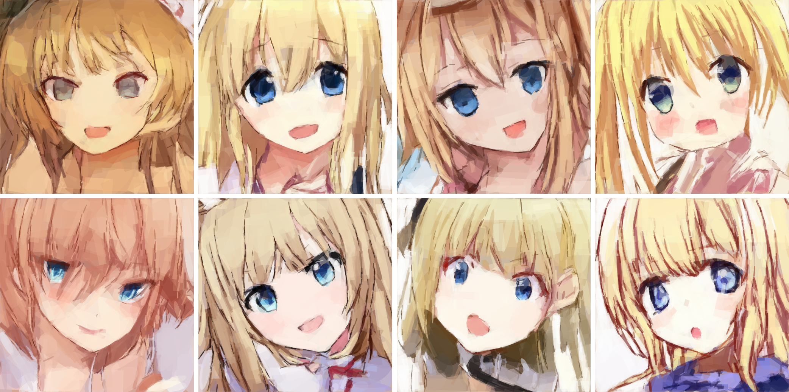

# Primitive Operation Painter 2

[English](README.md) | 中文

**查找第一代 POP 1？** [完整旧版快照](https://github.com/wonderfulearth/primitive-operation-painter/tree/pop1-144step) · [保留的旧版文件](legacy/pop1/) · [旧版介绍](legacy/pop1/README.md)

**一个通过可编辑图元操作进行绘画的自回归图像模型。**

Primitive Operation Painter 2（POP 2）通过预测背景以及一系列矩形和椭圆来构建图像。每个图形都有明确的几何参数和颜色。整个绘画过程会保留为数据：你可以查看它、修改某个图形、回到更早的状态，再让模型从修改后的位置继续绘制。

这个项目探索一种人与模型共用的绘画表示。人可以直接操作模型读取和写入的同一组绘制操作，无须把每一次修改都转述为另一条提示词。

本次发布包含 **GPU 图像转序列工具、模型架构、训练与 Python 推理代码，以及原生 Windows 应用的完整源码**。应用让模型更便于使用；数据与训练工具则让其设计可供研究和进一步开发。

[下载 Windows 应用](https://github.com/wonderfulearth/primitive-operation-painter/releases/download/pop2-1b/PrimitivePainter-0.9.29-Setup.exe) · [下载模型](https://huggingface.co/doubixz/primitive-operation-painter-2-1b) · [训练或微调](model/README.md) · [生成训练序列](data_tools/image_to_sequence/README.md)

## 生成示例



这八个结果取自一次生成 32 个结果的实验，是其中连续的八个候选。实验使用本次发布的 **Epoch 60** 模型，设置为 **CFG = 1**、**Rényi α = 4**，并启用滚动区域上下文。所有结果都从文本和绘画 BOS 开始，没有参考图像或真值图元前缀。这些图像直接由模型输出的图元序列渲染而成，没有图像精修阶段。

原始提示词：

> 金发蓝眼的白皙圆脸女性以明亮动画风呈现，张嘴露舌，粉色背景可见，取景包含头部和肩颈。

英文版中供读者参考的译文：

> A fair-skinned, round-faced woman with blonde hair and blue eyes, in a bright anime style, with her mouth open and tongue out. A pink background is visible; the framing includes her head, shoulders, and neck.

这些候选展示了同一条提示词产生的变化，其中也包括对指定属性遵循不完整的情况。当前检查点主要围绕动漫人脸和中文描述开发。[示例设置与来源记录](assets/readme/generated_examples.json)

## 你可以做什么

- **根据中文文本、已有图元，或两者共同生成。** 从空白画布开始，或让模型续画一段图元前缀。
- **查看并编辑绘画本身。** 移动、缩放、旋转、改色、添加、删除、复制原生图形，或调整其顺序，然后从编辑后的状态继续生成。
- **探索不同结果，同时保留先前的工作。** 应用将生成完成的图元和已提交的编辑记录到分支状态树中。你可以回到某个节点，创建新的续画分支，也可以并行生成多个独立分支。
- **重新绘制选定区域。** 修改模式支持遵循绘制阶段的局部重绘，同时保留所选范围之外的操作。重绘前，某些存在依赖关系的区域必须显式清除。
- **续画已转换为序列的参考图像。** 裁剪图像，将其近似分解为达到指定误差阈值的原生图形，查看结果，再显式导入以继续绘制。Transformer 接收的是分解得到的图形，而非原始图像像素。
- **研究或重新训练系统。** 将自己的图像转换为绘画轨迹，准备描述文本，从头训练或从已发布权重初始化，并查看实际使用的监督与解码实现。

## 从 POP 1 到 POP 2

首个公开模型确立了核心思路：图像生成器可以通过人能够编辑的绘制操作来工作。其发布模型能将较短的前缀续画为 **144 步绘画**，**有效分辨率为 256 × 256**。当时的图元已能表达可辨识的结构和颜色，但较短的序列限制了精细程度。

POP 2 在这一思路上加入了**图元历史压缩、共享历史的属性监督、从全局到局部的绘制、中文文本条件和自适应采样**。它的原生有效画布为 **512 × 512**；当单个上下文窗口填满时，应用可以通过选取区域历史来继续绘画。

| 方面 | POP 1 公开版本 | POP 2 |
|---|---|---|
| 主要输入 | 已有图元前缀 | 中文文本、图元前缀，或两者共同输入 |
| 历史表示 | 各属性分别占用 token | 每个完整图元占用一个历史位置 |
| 绘制组织 | 较短的全局序列 | 全局阶段、4 × 4 粗区域、8 × 8 细区域 |
| 有效画布 | 256 × 256 | 512 × 512 |
| 交互 | 序列与渲染工具 | 原生编辑器、分支历史、区域编辑与续画 |
| 默认采样方式 | 按计划调整温度与 top-k | 先用 Rényi 熵自适应确定候选集合，再等概率采样 |

POP 1 与 POP 2 使用不同的架构、token 布局和检查点。[早期模型包](https://huggingface.co/doubixz/primitive-operation-painter-weight)仍作为独立版本保留。

更新前的整个仓库以 `pop1-144step` 标签保留，同时在 [legacy/pop1](legacy/pop1/) 中提供完整副本，包含当时的介绍、代码和示例。旧版源码还保留在原来的根目录路径；本代训练与推理请使用 `model/` 下的新入口。

## POP 2 如何工作

### 以可编辑几何图形作为图像表示

每个普通图元包含九个离散属性：

```text
x, y, angle, width, height, shape, red, green, blue
```

模型按顺序预测这些属性，因此，同一图形中较后的属性依赖于先前的选择。确定性渲染器将操作历史转换为可见画布。普通图形使用固定不透明度；透明度不是额外的预测属性。

模型处理的是这一参数序列。图像分解与渲染由独立组件完成；生成过程不需要 VAE 图像解码器或扩散精修阶段。SVG 导出保留原生几何图形，但以更高分辨率导出不会创造额外的学习所得细节。

### 九个属性共用一个历史位置

一个图元完成后，它的九个属性嵌入会相加，合并为**一个 Transformer 历史位置**。与让每个属性分别占用一个位置相比，**图元历史位置数量缩减为 1/9（9:1）**。文本和绘画控制记录仍会占用上下文位置。

当前尚未完成的图元仍保留属性级依赖。已知属性会与各字段专属的、**可学习的空属性嵌入**组合，用来表示尚未预测的值。因此，未知属性有自身学到的表示，而不是被隐含地当作零向量。

这种方式缩短了历史长度，同时不必让相互独立的输出头去选择彼此无关的图形组成部分。历史位置数量的缩减，并不意味着总内存或总计算量也降低九倍。

### 共享历史的 Multi-Lane 注意力支持训练

不同属性的预测需要读取相同的已完成图形，却需要当前图形不同的部分信息。POP 2 只计算一次完整历史，并将其共享给各个属性查询分支。每个分支加入自身对应的部分图元状态；其注意力掩码允许访问相应的先前历史，并排除其他分支的预测。

默认情况下，训练会在**每个符合条件的图元位置上，有放回地采样两个属性监督查询**。这种做法降低单条序列内的监督密度，使给定分支预算下能够训练更多序列。推理时，图形的各属性仍按自回归方式预测。

生产实现将历史流与查询流中的线性运算和逐元素运算合并执行，并使用融合的 FlexAttention 处理分支注意力。源码包含[模型](model/model_gpt.py)、[部分图元构建与监督](model/block_state.py)，以及[融合注意力掩码和内核](model/fused_multilane.py)。

### 从全局到局部绘制，为序列赋予空间结构

较长的绘画轨迹不仅需要更多上下文，也需要有用的组织结构。POP 2 先建立整幅图像，再在逐步缩小的区域内绘制：

| 阶段 | 范围 | 普通图形数量上限 |
|---|---|---|
| 全局 | 整个画布 | 除背景外，最多 85 个 |
| 粗区域 | 4 × 4 网格 | 每个区域最多 20 个 |
| 细区域 | 8 × 8 网格 | 每个区域最多 10 个 |

区域约束作用于图形中心；图形本身可以跨越边界。显式记录分别标记区域开始、为稍后续画而中断，以及永久完成。数据生成器会生成常规轨迹和扰动轨迹，包括中断和重新访问区域的情况。

这些是**各区域的数量上限**，并不保证每个区域都达到上限时的全部内容能够装入一个窗口。训练序列在额外加入绘画 BOS 之前，有 **896 条记录**的预算，其中包含背景和控制记录。文本与绘画共同使用模型的 **1024 位置注意力窗口**。

应用的**上下文超频**在窗口空间紧张时保留选定历史：优先保留全局内容、粗区域阶段内容和相关细区域，并为后续绘画预留空间。完整画布和状态树仍会保留。这扩展的是应用能够管理的操作历史长度，并不会扩大模型的注意力窗口或 RoPE 容量。公开的 Python 参考命令行工具仍限制在单个窗口内。

### 中文文本与无分类器引导控制生成

文本通过随附的 **1500 词片 SentencePiece 分词器**编码，并置于绘画历史之前。文本嵌入作为绘画模型的一部分参与训练；此检查点不依赖单独预训练的语言编码器。训练中也包含空文本样本。

无分类器引导（classifier-free guidance）比较有文本条件与空文本条件下的预测。已发布的推理流程在采样前组合 **logits**：

```text
guided_logits = unconditional_logits
              + CFG × (conditional_logits − unconditional_logits)
```

**CFG = 1** 是普通的文本条件生成基线。提高引导强度会改变文本条件的影响，也可能减少变化或引入瑕疵。两条路径共享模型权重，但各自维护独立的 KV 历史。

### Rényi 熵自适应调整采样范围

适合的候选范围会随属性、绘制阶段和图像而变化。POP 2 根据当前合法输出分布计算 Rényi 熵，并将其转换为有效候选数量：

```text
candidate_count = clamp(round(exp(Rényi_entropy)), 1, legal_candidate_count)
```

采样器保留对应数量的最高概率候选，并在**保留的集合内等概率抽样**。集合内部不使用按概率加权的温度采样。分布决定选择范围应有多宽；等概率选择则保留入选候选之间的变化。这是一种采样规则，并不保证每个入选候选都正确。

默认起始设置为 **CFG = 1** 和 **Rényi α = 4**，两者均可调整。

## 已发布模型

| 属性 | 数值 |
|---|---|
| 模型 | POP 2 / 内部版本 v3.3 |
| 参数量 | 1,004,182,914 |
| Transformer 层数 | 35 |
| 隐藏维度 | 1536 |
| 注意力头 | 24，每头维度 64 |
| 门控 FFN 隐藏维度 | 4096 |
| 位置编码 | RoPE |
| 权重存储 | BF16 |
| 总注意力上下文 | 文本与绘画合计 1024 个位置 |
| 文本前缀上限 | 224 个 token，包含 BOS/EOS |
| 文本词表 | 1500 |
| 图元与控制词表 | 7069 |
| 原生有效画布 | 512 × 512 |
| 已发布检查点 | Epoch 60 / global step 10020 |

从 **[doubixz/primitive-operation-painter-2-1b](https://huggingface.co/doubixz/primitive-operation-painter-2-1b)** 下载。BF16 权重文件约 **2.01 GB**，并附有配套分词器。公开下载不需要 Hugging Face 账号。

模型包包含推理权重和元数据，不包含精确恢复训练所需的优化器分片。从该模型包开始微调时，会使用新的优化器。这一自定义架构需要配套的 POP 2 实现，无法直接使用通用文本模型加载器。

## 使用 Windows 应用

原生 Windows 应用使用 **Rust 和 C++** 编写。其界面不在浏览器中运行，安装后的推理也不需要 Python 环境。

编辑器提供矢量画布、绘画进度视图，以及带缩略图、分支聚焦视图和小地图的状态树。生成完成的图元和已提交的用户编辑会成为历史节点。回到某个节点并继续绘制，会创建新分支。并行生成会从相同起始状态创建多个续画结果。

需要介入时，先停止生成，编辑画布，再继续。标准模式和修改模式支持遵循绘制阶段的编辑，并按区域规则进行局部续画。参考图导入提供正方形裁剪、可配置的基于 RMSE 的分解、预览，以及显式导入步骤。项目文件保留状态树；最终画布可导出为 **PNG 或 SVG**。

安装 Windows Setup 安装包后，通过 **Settings → Model and runtime（设置 → 模型与运行环境）** 下载权重或选择本地副本。运行时组件与权重从体积较小的安装程序之外单独下载。在线安装流程会下载所需的运行时组件与权重。这些文件就绪后，生成过程不需要应用账号或付费服务。

应用根据检测到的设备与运行时选择 NVIDIA、AMD 或 CPU 执行。优化包括前缀/KV 复用、批处理、GPU 采样、融合操作、图执行，以及**受支持时的 KV INT8**。可用功能因后端而异。兼容性提示会说明被禁用的功能；诊断日志会标明实际计算后端和回退原因。

Windows 11 开发中使用过 RTX 5070 Ti Laptop 和 RX 7900 XTX。纯净 Windows Sandbox 检查涵盖安装、CPU/WARP 界面，以及通过虚拟 GPU 进行的有限真实 CUDA 生成。参见[应用要求与已测试范围](app/README.md)。CPU 回退较慢；参考图像分解需要受支持且具备计算能力的图形适配器。

应用版本为 **0.9.29**，与模型代际和训练轮次分别编号。分发包包含此前测试过的 0.9.29 安装程序；尚未使用整理后的候选源码复现该确切二进制文件。参见[二进制来源](docs/binary_provenance.md)和[分发详情](distribution/README.md)。

## 运行 Python 推理

先安装适合你硬件的 PyTorch 版本。在仓库根目录运行：

```sh
python -m pip install -r model/requirements.txt
python -m pip install "huggingface_hub>=0.34,<2"
python tools/download_model.py
python model/infer.py --checkpoint weights/pop2-1b-epoch60/model.pt --prompt "金发蓝眼的白皙圆脸女性，明亮的动画风格。" --batch 1 --alpha 4 --cfg 1 --output work/inference
```

下载工具固定使用经过验证的模型修订版，并检查文件大小和 SHA-256。推理会输出 PNG、图元数组和结果 JSON。命令行工具接受中文文本、无文本输入，以及可选的全局阶段图元前缀，并会报告生成是已完成，还是达到了上下文或记录数量上限。

有关批处理、引导、可选编译和输入要求，参见 [Python 参考推理](model/README.md#python-reference-inference)。任意画布编辑、分支和滚动上下文属于应用功能。

## 生成数据与训练

数据流程使用 GPU 候选搜索、变异和解析颜色拟合，将图像近似为几何操作。它可以为每张图像生成多条随机绘画轨迹，而不假定存在唯一正确的绘制顺序。每张图像的描述文本同样可以有多个变体。

```text
你的图像 → GPU 图元分解 → 打包的 CSV 绘画轨迹
你的描述文本 → 分词器与描述缓存
绘画轨迹 + 描述缓存 → 训练 → 检查点 → 推理或应用
```

Rust/WGPU 转换工具在 Windows 上使用 DX12，在 Linux 上使用 Vulkan，并提供 macOS 的 Metal 路径。本次发布尚未在 macOS 硬件上验证。打包的 CSV 分片、完成清单和事务性写入支持转换中断后的处理。[转换工具文档](data_tools/image_to_sequence/README.md) · [描述文本格式](data_tools/captions/README.md)

可使用随附的合成示例检查训练流程：

```sh
python model/prepare_data.py --data-dir examples/synthetic/sequences --captions examples/synthetic/captions.json --output work/synthetic-captions
python model/train.py --data-dir examples/synthetic/sequences --caption-root work/synthetic-captions --checkpoint-dir work/tiny-checkpoints --versions 1 --epochs 2 --micro-batch 1 --accumulation 1 --tiny --from-scratch
```

这用于检查协议和训练流程；合成示例本身并不是有实用价值的训练语料。完整规模训练支持单设备或多 GPU 执行、梯度累积、可选的 GPU FP32 主权重和优化器状态分片，以及从完整检查点恢复。生产融合训练面向兼容的 **Linux CUDA/ROCm PyTorch 与 Triton 软件栈**；支持 Windows 应用，并不意味着每台 Windows 机器都具有同等的 Python 训练支持。

公开训练器可以使用你自己的本地数据或挂载数据，不依赖原始云实例、私有传输服务、固定 GPU 数量或原始图像列表。过长的描述文本会被明确拒绝。[训练、初始化与精确恢复](model/README.md)

## 仓库内容

| 目录 | 内容 |
|---|---|
| [`data_tools/`](data_tools/image_to_sequence/README.md) | GPU 图像分解、CSV 回放与描述文本输入约定 |
| [`model/`](model/README.md) | 模型、监督、数据加载、训练、检查点与 Python 推理 |
| [`app/`](app/README.md) | 原生 Windows 编辑器、模型后端、内核，以及构建与安装程序源码 |
| [`tools/`](tools/download_model.py) | 公开权重下载与校验 |
| [`examples/`](examples/synthetic/) | 完全合成的图像与端到端序列示例 |
| [`docs/`](docs/architecture.md) | 架构、协议、权重、发布范围与验证 |
| [`third_party/`](THIRD_PARTY_NOTICES.md) | 依赖项许可证与声明 |
| [`legacy/pop1/`](legacy/pop1/README.md) | 保持原文件内容的第一代工程与介绍 |

模型权重托管于 Hugging Face。Windows 安装程序与 Git 源码分开分发。本次发布不包含原始训练图像、完整描述文本语料、优化器检查点、私有部署工具或开发缓存。

## 范围与局限

POP 2 是用于可编辑图像生成的研究原型。其检查点专注于动漫人脸和中文描述。它可能遗漏要求的属性、生成畸形特征，或让编辑后的续画朝预期之外的方向发展。紧凑的分词器也限制了应用能够表示的输入文本范围。

原生绘画支持矩形、椭圆和背景，以及阶段与区域控制。它不提供任意贝塞尔路径、通用 SVG 导入、照片级真实纹理合成或通用语言对话。参考图续画可以在粗略近似的基础上添加模型生成的细节，但不保证恢复原始图像中缺失的细节。

核心能力在于能够访问明确的绘画过程：几何、顺序、编辑和不同历史分支都保持可查看。未来工作可以在这一表示中研究更好的模型、数据、采样和后训练。本次发布不包含能理解任意编辑指令或对自身输出进行视觉评价的自主智能体。

## 验证与许可

检查包括对合成图像进行真实 GPU 转换、将其序列加载到训练器、协议测试、小模型的训练/保存/精确恢复/推理全流程，以及原生应用的回归与兼容性检查。应用 CPU 测试套件通过了 **663 项测试**。这些检查不构成对完整 1B 模型训练过程的新一轮复现。参见[验证记录](docs/validation.md)。

项目自身源码采用 **[MIT 许可证](LICENSE)**。模型许可见 [Hugging Face 发布页面](https://huggingface.co/doubixz/primitive-operation-painter-2-1b)。第三方依赖保留各自的许可条款；参见 [THIRD_PARTY_NOTICES.md](THIRD_PARTY_NOTICES.md)。请使用你有权使用的图像和描述文本；原始训练语料不随代码分发。

贡献说明见 [CONTRIBUTING.md](CONTRIBUTING.md)。引用元数据位于 [CITATION.cff](CITATION.cff)。
